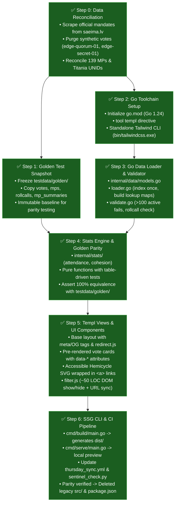

# kabalsosaeima Refactor Dependency Tree

> **Current Branch:** `refactor/go-ssg`  
> **Target:** Replace fragile Node/Vite frontend with a type-safe Go static site generator (SSG) producing pre-rendered HTML + SVG and zero monthly hosting costs.

---

## 1. Dependency Graph

---

## 2. Node Status & Verification Gates

### [x] Step 0: Data Reconciliation & Ground Truth
- **Branch:** `main` (commit `45aba0d`)
- **Deliverables:**
  - `scripts/scrape_mandates.py`: Scrapes official 14. Saeima dossiers from Titania.
  - `public/data/mandates.json`: 139 deputies with official intervals and provenance URLs.
  - `public/data/mps.json`: Reconciled 139 deputies with `saeimaId` (UNID) and ASCII `slug`.
  - Deleted synthetic votes (`edge-quorum-01`, `edge-secret-01`).
- **Verification Gate (PASSED):**
  - All 34,873 rollcall records audited: **0 conflicts**.
  - All 8 sitting dates checked: **exactly 100 active mandates**.
  - Consecutive runs of `scrape_mandates.py` diff **only `fetchedAt`**.

---

### [x] Step 1: Golden Test Snapshot
- **Branch:** `refactor/go-ssg`
- **Objective:** Freeze an immutable copy of the current clean data so that Go unit tests test against a fixed ground truth.
- **Tasks:**
  1. Create directory `testdata/golden/`.
  2. Copy `public/data/votes.json`, `public/data/mps.json`, `public/data/mandates.json`, `public/data/mp_summaries.json`, and `public/data/rollcalls/` into `testdata/golden/`.
  3. Verify file integrity and size.
- **Verification Gate (PASSED):** `testdata/golden/` exists, contains all 398 votes, 139 MPs, 139 mandates, 136 summaries, and 398 rollcalls, and is committed.

---

### [x] Step 2: Go Toolchain Setup
- **Branch:** `refactor/go-ssg`
- **Tasks:**
  1. Initialize `go.mod` for `github.com/FisersDavis/kabalsosaeima` (Go 1.24+).
  2. Add `tool (github.com/a-h/templ/cmd/templ)` in `go.mod`.
  3. Download standalone Tailwind CLI into `bin/tailwindcss.exe`.
  4. Create `assets/input.css` with `@source "../internal/views/**/*.templ"`.
- **Verification Gate (PASSED):** Go toolchain installed (Go 1.27.0); `go tool templ version` works (`v0.3.1070`); `./bin/tailwindcss.exe --help` executes cleanly.

---

### [x] Step 3: Go Data Loader & Validator
- **Package:** `internal/data`
- **Tasks:**
  1. `models.go`: Strongly-typed Go structs for Vote, MP, Rollcall, Mandate, Faction.
  2. `loader.go`: "Parse once, index once" into startup lookup maps (`votesByID`, `mpByID`, `mandateByMpID`, `rollcallsByMP`).
  3. `validate.go`: Required fields check, rollcall participation invariant, and chamber size ceiling ($>100$ fails build).
- **Verification Gate (PASSED):** `go test -v ./internal/data/...` passes against `testdata/golden/` (398 votes, 139 MPs, 139 mandates, 0 violations, ceiling assertion catches artificial breach).

---

### [x] Step 4: Stats Engine & Golden Parity
- **Package:** `internal/stats`
- **Tasks:**
  1. `attendance.go`: Calculate attendance denominator *only* over active mandate intervals.
  2. `cohesion.go`: Faction unity using historical rollcall `factionId`.
  3. `timeline.go`: Group bill readings (1st, 2nd, 3rd) and amendments by bill number.
  4. `stats_test.go`: Compare calculated stats against `testdata/golden/mp_summaries.json` for all continuous MPs.
- **Verification Gate (PASSED):** `go test -v ./internal/stats/...` passes with 100% equivalence (86 continuous MPs, documented ministers and switchers, bill timeline grouping).

---

### [x] Step 5: Templ Views & UI Components
- **Package:** `internal/views`
- **Tasks:**
  1. `layout.templ`: HTML5 shell, OpenGraph tags, Tailwind CSS, `assets/js/redirect.js`.
  2. `overview.templ`: Pre-rendered vote cards with `data-*` filter attributes.
  3. `vote.templ`: Vote permalink with pre-rendered Hemicycle SVG (`<a href="/deputati/{slug}/">` with native `<title>` tooltips).
  4. `bill.templ`: Progression timeline for `/likumprojekti/{cleanBillSlug}/`.
  5. `mp.templ`: MP dossier, attendance badges, and historical votes.
  6. `assets/js/filter.js`: ~50 LOC vanilla JS that shows/hides pre-rendered cards and syncs URL query parameters.
- **Verification Gate (PASSED):** `go generate ./...` (`templ generate`) compiles with 0 errors; `go vet ./...` passes cleanly; `go test -v ./...` passes all unit tests (7/7 in views).

---

### [x] Step 6: SSG CLI, CI Pipeline & Cleanup
- **Package:** `cmd/build`, `cmd/serve`
- **Tasks:**
  1. `cmd/build/main.go`: Loads data, runs validator, compiles Tailwind CSS, copies static assets, and generates full static site in `dist/` (398 vote permalinks, 203 bill progressions, 139 MP dossiers, overview feed).
  2. `cmd/serve/main.go`: Minimal local HTTP dev server for `dist/`.
  3. Update `.github/workflows/thursday_sync.yml` and `scripts/sentinel_check.py`.
  4. Perform complete route and data parity check against old React build.
  5. Delete legacy React files (`src/`, `package.json`, `package-lock.json`, `vite.config.ts`, `node_modules/`).
- **Verification Gate (PASSED):**
  - Single command `go run ./cmd/build` outputs full working site to `dist/` in ~2s.
  - `go run ./cmd/build --validate-only` completes in ~56ms.
  - `sentinel_check.py` smoke test passes in live and integrity modes.
  - `go generate ./...`, `go vet ./...`, and `go test -v ./...` pass cleanly.
